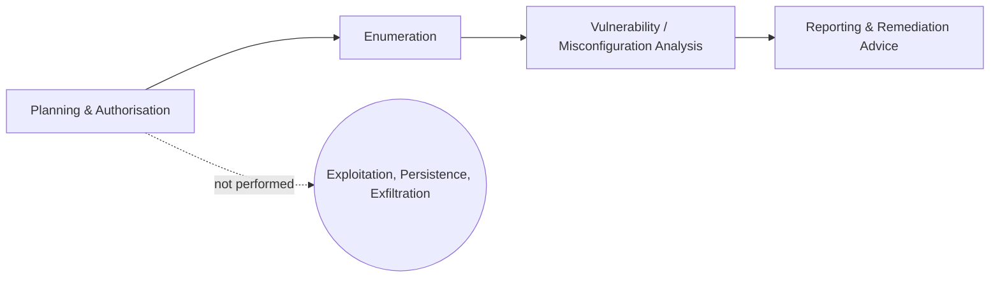

# CIS Benchmark Checker (Kali Remote Edition)

**Category:** Auditing (Category 5) | **Runs on:** Kali Linux | **Audits:** Windows 10 / 11 | **Language:** Python 3.10+ | **Version:** 1.0.0

## 1. Description

A **read-only** configuration auditor. You run it on Kali; it connects to an authorised Windows 10/11
machine over WinRM, collects security settings using a fixed set of read-only PowerShell queries, and
evaluates them **on the Kali side** against 60 CIS-aligned controls. It produces console, JSON, CSV and
HTML reports with evidence and remediation advice.

It does not exploit anything, does not change any setting, and writes no files to the target.

> **Not a CIS certification.** This is a selected-control auditor. Controls ending in `.x` have a known
> section but the exact number varies between benchmark releases. Verify against the release you cite.

## 2. Attack lifecycle mapping

This is a defensive tool, so it maps to the **assessment** side of the lifecycle and deliberately stops
before exploitation.



| Lifecycle stage | What the tool does | Code |
|---|---|---|
| Planning & authorisation | Banner (Computer Crimes Act), scope + time-window enforcement, typed per-target confirmation | `safety.py` |
| Enumeration | Identifies OS/build, collects registry, policy, firewall, service, Defender and audit settings in 8 read-only batches | `collector.py`, `backends.py` |
| Misconfiguration analysis | Compares each value with the catalogue (`eq/in/ge/le/between/includes`), applies per-control "not configured" defaults | `evaluator.py`, `catalog.py` |
| Reporting | JSON / CSV / HTML / console with evidence, severity, CIS ref, remediation | `report.py` |
| Exploitation / persistence / exfiltration | **Intentionally not implemented** | n/a |

## 3. Installation (Kali Linux)

```bash
git clone <YOUR_REPO_URL> && cd CIS-Benchmark-Checker-Kali
python3 -m venv .venv && source .venv/bin/activate
pip install -r requirements.txt        # only pywinrm; demo/dry-run/tests need nothing
python3 -m unittest discover -s tests  # 21 tests
```

### Preparing the Windows target (done by the system owner, in a lab or with written permission)

1. Use an **isolated lab network** (e.g. VirtualBox/VMware host-only `192.168.56.0/24`).
2. In an *elevated* PowerShell on the target: `Enable-PSRemoting -Force`
3. Create a dedicated audit account and add it to **Administrators** (some checks, e.g. `auditpol`, need admin).
4. When finished: `Disable-PSRemoting -Force` and delete the audit account.

WinRM over HTTP (5985) with NTLM encrypts message payloads; use `--ssl` (5986) where a certificate is available.
Local non-built-in admin accounts may get a filtered token over the network, which can turn a few checks into
`ERROR` or `REVIEW`. Use the built-in Administrator or a domain account in the lab.

## 4. Usage

```bash
python3 -m cischeck --list-checks                         # all controls
python3 -m cischeck                                       # DRY-RUN on 127.0.0.1: contacts nothing
python3 -m cischeck --demo                                # full pipeline on synthetic data, no network
python3 -m cischeck --live --target 192.168.56.101 --scope 192.168.56.0/24 -u 'LABPC\auditor' \
        --window 09:00-18:00 --engagement-id LAB-2026-01
python3 -m cischeck --live --target win11-lab --scope win11-lab -u auditor --ssl \
        --sections "Windows Firewall,Account Policies"
```

The password is prompted (hidden) or read from `--password-env VAR`. It is never a CLI argument, never
written to disk and never logged. Run `python3 -m cischeck --help` for all options.

**Output** goes to `./output/audit_<target>_<UTC time>/` (directory `0700`, files `0600`):
`audit_report.html|json|csv` and `raw_snapshot_EVIDENCE.json`. All carry a CONFIDENTIAL label.

**Statuses:** `PASS`, `FAIL`, `REVIEW` (setting absent/ambiguous: a human must decide), `ERROR` (could not collect).
Compliance % = PASS / (PASS + FAIL); REVIEW and ERROR are reported separately and never counted as a pass.

## 5. Controls covered (60)

Account Policies (8) · Windows Firewall + Defender (9) · UAC (5) · Interactive Logon (3) · Network & Authentication (12) ·
Windows Components (9) · Remote Access (2) · System Services (5) · Advanced Audit Policy (7). See `--list-checks`.

## 6. Ethical considerations (guardrails and why)

| Guardrail | Behaviour | Reason |
|---|---|---|
| Dry-run by default | No flags = prints a plan, contacts nothing. `--live` is required to connect | Accidental runs cannot touch anything |
| Safe default target | `127.0.0.1` | Required default |
| Scope enforcement | Non-loopback targets need `--scope`; target must be inside it; scopes above /24 rejected | Scope is the legal boundary |
| Public IP refusal | Public addresses refused unless `--allow-public` | Most real-world misuse is mis-typed or public targets |
| Typed consent | Must type `I AM AUTHORIZED TO AUDIT <target>`; no `--yes` bypass; refuses without a terminal | Forces a conscious, target-specific decision |
| Time window | `--window HH:MM-HH:MM` refuses to run outside it | Honours agreed testing windows |
| Read-only guard | Every script is regex-checked before it is sent; any `Set-/New-/Remove-/Invoke-`, redirects, `reg add`, `net user`, `net accounts /...` etc. abort the run | Technical enforcement of "read-only", not just a promise |
| Kill switch | Ctrl+C, SIGTERM or a stop file, checked before every remote call | Clean, immediate abort |
| Minimal data | Only configuration values are collected: no password hashes, user lists, files or event logs | Data minimisation |
| Local-only storage | Nothing is transmitted anywhere; restrictive permissions; CSV formula-injection neutralised | No exfiltration |

## 7. Rules of Engagement (RoE)

- **Authorised scope:** only hosts/ranges listed in `--scope`, and recorded in the written authorisation. Maximum /24; one target per run.
- **Time windows:** only within the agreed window; enforce it with `--window`. Default recommendation: business hours, or an agreed maintenance slot.
- **Permitted techniques:** authenticated, read-only WinRM queries listed in `catalog.py` / `collector.py`.
- **Prohibited actions:** modifying any setting, remediating automatically, installing software, writing files to the target, password guessing or spraying, exploiting vulnerabilities, auditing hosts outside scope, copying evidence off the assessor's machine, or using `--allow-public` / `--insecure` without written approval.
- **Emergency stop:** press **Ctrl+C**; or from another terminal `touch /tmp/cischeck.STOP` (also `./STOP`); or `pkill -TERM -f cischeck`. The tool stops before its next query. Afterwards tell the system owner, and if anything unexpected happened on the target (lockouts, alerts, instability) report it immediately. The tool changes nothing, so no rollback is needed.
- **Credentials:** use a dedicated audit account, rotate or delete it after the engagement.

## 8. Responsible disclosure

- **Who:** report findings only to the **system owner / engagement contact** named in the authorisation (not to third parties or public channels).
- **When:** deliver the report within the agreed timeframe; treat **High-severity FAIL** items as urgent (suggested: notify within 24-48 hours). Allow a reasonable remediation period (commonly 90 days) before any public discussion, and only with the owner's written consent.
- **How:** share reports through an encrypted or access-controlled channel, label them CONFIDENTIAL, and share only what is needed. Delete local copies when the engagement agreement says so.
- **Bugs in this tool:** open a private security advisory on this repository, or email `<YOUR EMAIL>`.

## 9. Legal disclaimer

For authorised use only. Unauthorised access to computers is an offence under the **Computer Crimes Act 1997
(Act 563), Malaysia** (including ss.3, 4 and 5) and equivalent laws elsewhere. The authors accept no liability
for misuse. The tool displays this notice at every start and requires typed confirmation before any live connection.

## 10. Limitations

- Needs WinRM enabled on the target, and administrator rights for some checks (`auditpol`, Defender status).
- `net accounts` / `auditpol` output parsing assumes an English-language target; otherwise affected checks become `REVIEW`/`ERROR`.
- Local policy only: domain GPO values are what Windows reports as effective, but domain-wide analysis is out of scope.
- 60 selected controls, not the full benchmark (hundreds). Level 1 / Level 2 profiles are not distinguished.
- Single target per run. No automatic remediation (by design).
- Demo mode uses synthetic data. Live WinRM behaviour depends on your lab's configuration.

## 11. Project layout

```
cischeck/  cli.py  safety.py  catalog.py  collector.py  backends.py  evaluator.py  report.py  demo_data.py
tests/     test_cischeck.py       requirements.txt   LICENSE (MIT)   .gitignore
```
